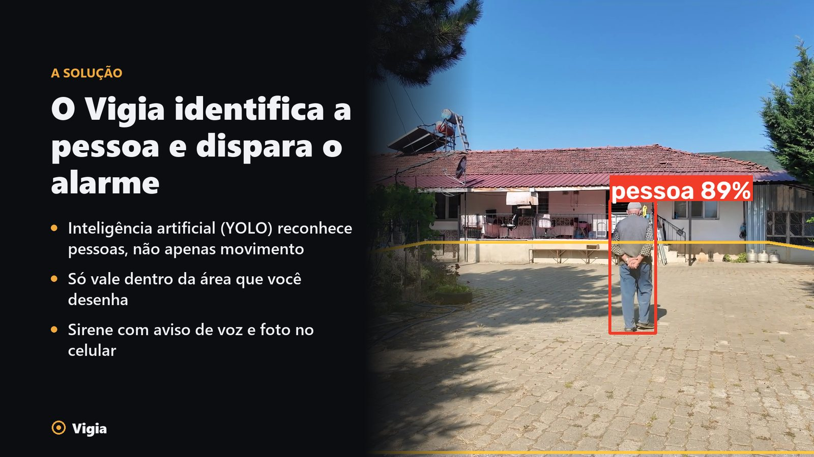
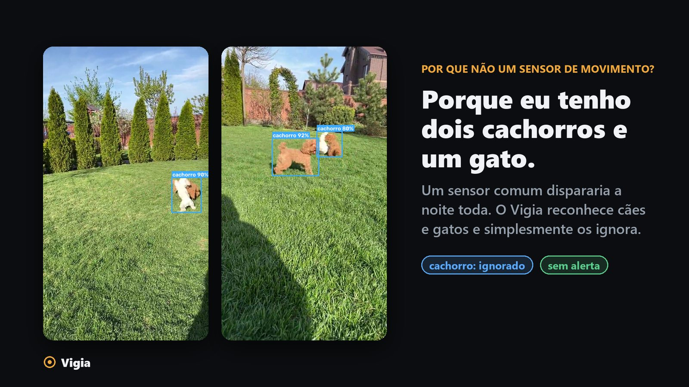
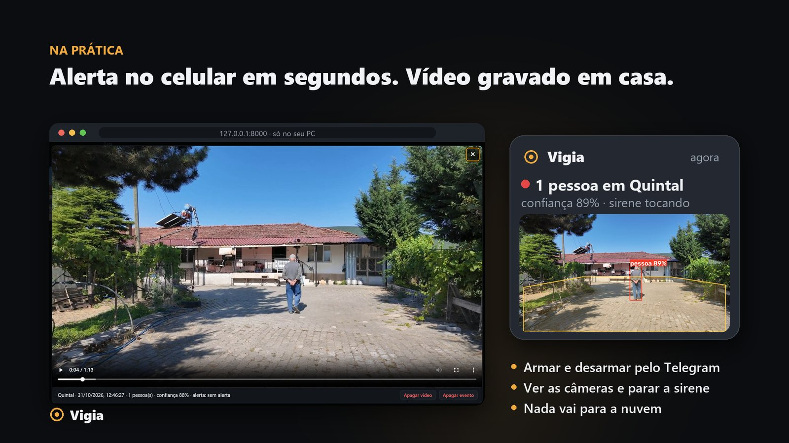

# Vigia: monitoramento das câmeras

Detecta pessoas nas câmeras de um DVR/NVR ou câmera IP com RTSP (testado com Intelbras MHDX; formatos de Dahua, Hikvision, XMeye e Uniview incluídos), grava vídeo do evento e manda alerta com foto pelo Telegram. Roda num PC Windows da mesma rede local e tem um painel web em **http://127.0.0.1:8000**.

```
PC com o Vigia ── rede local ── DVR (RTSP, porta 554) ── câmeras
      └── internet (só saída) ── Telegram
```

Tudo roda localmente: nenhuma imagem sai de casa, exceto as fotos de alerta enviadas ao seu Telegram.



**Por que não um sensor de movimento?** Em casa com cachorros e gatos, ele dispararia a noite toda. O Vigia reconhece os animais e os ignora; só uma **pessoa** dentro da área escolhida gera alerta.



## Instalação (uma vez)

```powershell
cd C:\sistema-monitoramento
python -m venv .venv
.\.venv\Scripts\python.exe -m pip install -r requirements.txt
.\.venv\Scripts\python.exe main.py --abrir
```

Na primeira vez, o painel abre o **assistente de instalação** (também em Configuração → 🧭 Assistente de instalação):

1. **Câmeras**: procura o gravador na rede (inclusive atrás de um segundo roteador), pede usuário e senha e mostra as câmeras para escolher. Veja [Encontrar as câmeras](#encontrar-as-câmeras-qualquer-marca).
2. **Alertas no Telegram**: explica como criar o bot no @BotFather e pede o token. Cada pessoa que vai receber os alertas manda um "oi" ao bot e aparece na tela para ser marcada; quem é incluído recebe uma mensagem de boas-vindas. Dá para pular e fazer depois (Status → Telegram → Configurar).
3. **Pronto**: lembra de desenhar as zonas, o horário automático e a sirene.

O assistente grava as credenciais no `.env` sozinho. Se preferir editar à mão (`copy .env.example .env`), estas são as variáveis. O `config.yaml` não guarda nenhuma:

| Variável | O que é |
|---|---|
| `CAM_USER` / `CAM_PASSWORD` | Usuário e senha do DVR. O ideal é criar no DVR um usuário só de visualização para este sistema. |
| `TELEGRAM_BOT_TOKEN` | No Telegram, fale com **@BotFather** → `/newbot` → copie o token. |
| `TELEGRAM_CHAT_ID` | Pelo assistente, ou mande um "oi" para o seu bot e rode `python scripts\telegram_chat_id.py`. Para várias pessoas, separe por vírgula (`111,222`); cada uma precisa mandar "oi" ao bot antes. |

> ⚠️ O DVR bloqueia o usuário por cerca de 30 min depois de algumas senhas erradas. O sistema confere a senha **uma vez** ao iniciar: se ela for recusada, não insiste e mostra o aviso no painel.

## Encontrar as câmeras (qualquer marca)

No painel, aba **Configuração** → **🔍 Procurar câmeras**:

1. **Aparelhos na rede**: o Vigia procura gravadores e câmeras IP nas redes do PC (porta RTSP 554 e **ONVIF**) e mostra marca/modelo quando o aparelho informa. Se o gravador estiver atrás de outro roteador (ex.: PC em `192.168.0.x` e gravador em `192.168.1.x`, num roteador da operadora com um roteador Wi-Fi atrás), o Vigia detecta essa rede sozinho; se mesmo assim não achar, digite o IP ou a rede.
2. **Usuário e senha** do gravador. No aparelho já configurado, deixe a senha em branco para usar a do `.env`.
3. **Canais**: o Vigia descobre o formato da marca e mostra uma miniatura de cada canal. Canais sem câmera aparecem como "sem sinal". Marque as câmeras, dê nomes e clique em **Usar**. Usuário e senha vão para o `.env`; nomes e canais para o `config.yaml`. Depois, desenhe as zonas.

Como o formato é descoberto: primeiro testa os formatos conhecidos (Intelbras/Dahua, Hikvision/HiLook, XMeye/genéricos, Uniview). Se nenhum servir, pergunta ao aparelho pelo ONVIF. Até agora só o formato da **Intelbras** foi testado com aparelho real; os outros seguem a documentação dos fabricantes.

> ⚠️ Para não bloquear o usuário do gravador, a busca para no primeiro "senha recusada" e espera 5 min antes de aceitar outra tentativa no mesmo aparelho. Alguns gravadores (Intelbras/Dahua recentes) têm um **usuário ONVIF separado**; isso não atrapalha quando o formato da marca é reconhecido pelo RTSP.

## Testar

```powershell
# 1. Conexão com o DVR: descobre os canais com vídeo e salva fotos em snapshots\teste\
.\.venv\Scripts\python.exe scripts\testar_rtsp.py --canais 8

# 2. Pipeline completo sem câmera (vídeo gerado com pessoas de exemplo)
.\.venv\Scripts\python.exe scripts\gerar_video_teste.py
.\.venv\Scripts\python.exe main.py --video data\video_teste.mp4 --sem-alerta --abrir
```

No modo teste, os horários são ignorados e os eventos vão para `data\eventos_teste.db`. Tire o `--sem-alerta` para receber a foto no Telegram.

## Rodar

O jeito mais fácil é o atalho **Vigia** na área de trabalho. Ele inicia o programa em segundo plano, sem janela, e abre o painel. Se o programa já estiver rodando, só abre o painel. Para recriar o atalho, aponte-o para `.venv\Scripts\pythonw.exe "scripts\abrir_vigia.pyw"` com o ícone `assets\vigia.ico`.

Pelo terminal (vê o log na tela):

```powershell
.\.venv\Scripts\python.exe main.py --abrir
.\.venv\Scripts\python.exe main.py --ignorar-horario   # vigia o tempo todo, para testes
```

## Painel (http://127.0.0.1:8000)



- **Ao vivo**: as câmeras em grade. As caixas vermelhas são pessoas dentro da zona; as cinzas estão fora da zona e são ignoradas; as azuis são cachorros e gatos (nunca alertam). "Testar detecção" roda o detector na hora, mesmo fora do horário.
- **Eventos**: histórico com foto e vídeo, filtro por câmera e data, e o espaço ocupado pelos vídeos. Ao abrir um evento, você pode apagar só o **vídeo** (a foto e o registro ficam) ou o **evento** inteiro. Com **Selecionar** dá para apagar vários de uma vez. Sempre pede confirmação e não dá para desfazer.
- **Configuração**: nome e canal de cada câmera, horários, zonas (desenhadas clicando na imagem) e parâmetros de detecção. As mudanças valem na hora, sem reiniciar.
- **Status**: conexão, FPS, CPU, Telegram (com botão de teste) e o log.
- **Armado/Desarmado** (botão no canto superior direito): **armado detecta na hora, a qualquer horário**; desarmado não gera nada (eventos, gravações, alertas). Cada câmera também tem "Desarmar câmera" no rodapé da imagem (passe o mouse), que fica salvo na configuração.

O painel só aceita acesso deste PC. Para ver de fora de casa, use **Tailscale** (`python main.py --host <IP-100.x-do-Tailscale>`). **Nunca** faça redirecionamento de portas no roteador.

## Configuração (`config.yaml`)

Dá para editar pelo painel ou direto no arquivo (reinicie depois de editar o arquivo).

- **Horário automático** (`janelas`): no início do horário o sistema **arma sozinho** e no fim **desarma sozinho**. O botão manual vale a qualquer momento, até a próxima virada de horário (ex.: desarmar às 23:00 ao chegar em casa; às 06:00 ele já estaria desarmado de qualquer forma). Ao iniciar o programa, ele começa armado se estiver dentro do horário. `dias` aceita `seg ter qua qui sex sab dom`; janela que cruza a meia-noite pertence ao dia em que começa; `inicio == fim` = dia inteiro.
- **Zonas**: polígonos com coordenadas de 0 a 1. Uma pessoa conta se os pés (a base da caixa) estiverem dentro de alguma zona.
- **Anti-falso-positivo**: só alerta se houver pessoa em `k` dos últimos `n` frames analisados.
- **Intervalo entre alertas** (`cooldown_s`): no máximo 1 alerta por câmera nesse intervalo.
- **Modelo e resolução**: `yolo11s.pt` com `imgsz: 960` reconhece bem melhor pessoas distantes no infravermelho do que `yolo11n.pt` a 640. Na cena do quintal a confiança subiu de 37% para 68%.
- **Filtro de movimento** (`filtro_movimento`, `movimento_min`): o YOLO só roda quando pelo menos `movimento_min`% da imagem muda. Mesmo sem movimento, analisa a cada 15 s, e continua analisando enquanto houver pessoa recente. Isso reduziu a CPU de ~57% para ~13% com 4 câmeras. Para calibrar, veja a coluna "Movimento" na aba Status: com a cena parada, o valor deve ficar abaixo do limite.
- **Filtro de animais** (`filtro_animal`, `limite_animal`): cada "pessoa" detectada passa por um classificador (ImageNet) que estima a chance de ser um animal; acima do limite (padrão 0,6) ela é descartada e aparece no painel como "animal". Em testes com vídeos reais, cachorros ficaram entre 0,70 e 0,96 e pessoas entre 0,00 e 0,07 (mediana).
- **Pets**: cachorros e gatos nunca geram alerta. O detector também os reconhece (caixa azul no painel) e descarta uma "pessoa" que esteja na mesma posição de um pet com confiança parecida, o engano típico de um cachorro em pé no infravermelho. A coluna "Pets confundidos" na aba Status conta esses descartes.
- **Threads do detector**: variável `DETECCAO_THREADS` no `.env` (padrão 4).
- **Câmera nova**: use **🔍 Procurar câmeras** no painel (ou "+ Adicionar câmera" informando o canal).
- **Outras marcas** (`dvr.url_template`): além de `{user} {password} {host} {port} {channel} {subtype}`, aceita `{stream}` (= subtype + 1, usado pela Hikvision). O endereço é sempre o `{host}` do `.env`.
- **Arquivo pessoal**: o `config.yaml` (com os nomes e zonas das suas câmeras) é criado a partir do `config.example.yaml` na primeira execução e **não vai para o git**.

## Controle pelo Telegram

Envie ao bot (ou toque nos botões do **/menu**):

| Comando | O que faz |
|---|---|
| `/armar` | Arma agora (vale até a próxima virada do horário automático) |
| `/desarmar` | Desarma e desliga a sirene |
| `/status` | Estado, quem armou e quando, câmeras conectadas, sirene e eventos do dia |
| `/ver` | Foto atual de todas as câmeras, com as zonas e o que está sendo detectado. `/ver 2` mostra só a Câmera 2 |
| `/parar` | Desliga a sirene (também há um botão na mensagem do alerta) |

As fotos do `/ver` vão só para quem pediu. Quando alguém arma ou desarma pelo Telegram, os outros destinatários recebem um aviso. Só os chat ids do `TELEGRAM_CHAT_ID` são atendidos.

## Sirene pelo PC

Quando uma pessoa **continua na zona** por alguns segundos (com o sistema armado), o Vigia toca uma **sirene + aviso de voz** ("Atenção! Esta área é monitorada…") nas **caixas de som do PC**, em loop.

- Configure em **Configuração → Sirene**: ligar/desligar, atraso (`atraso_s`, padrão 5 s) e duração máxima (`duracao_s`, padrão 60 s). O botão **Testar sirene** toca 3 s.
- Para desligar: botão vermelho **"🔕 Parar sirene"** no painel, **desarmar** o sistema, ou pelo **Telegram** (botão na mensagem de alerta ou comando `/parar`).
- O volume é o do Windows. Para ser ouvida de longe, ligue uma **caixa de som amplificada** perto da área vigiada.
- O áudio é gerado no primeiro uso em `data/sirene.wav` (voz pt-BR do Windows, se instalada).

## Iniciar com o Windows

```powershell
powershell -ExecutionPolicy Bypass -File scripts\instalar_inicializacao.ps1
```

Isso cria a tarefa "Vigia - Monitoramento", que inicia ao entrar no Windows e reinicia se o programa cair. Para rodar mesmo **sem ninguém logado**, abra o Agendador de Tarefas, edite a tarefa e marque "Executar estando o usuário conectado ou não" (o Windows pede sua senha nessa tela).

**Suspensão do PC:** enquanto o Vigia está aberto, ele pede ao Windows para **não suspender**. A tela continua desligando normalmente, e o plano de energia não é alterado; ao fechar o Vigia, o PC volta a suspender como antes. Se o PC suspender por outro motivo (fechar a tampa do notebook, botão de energia), a detecção para até ele acordar, mas o DVR continua gravando no HD dele. Para desligar esse comportamento, use `main.py --permitir-suspensao`.

## Consultar eventos pelo terminal

```powershell
.\.venv\Scripts\python.exe scripts\ver_eventos.py -n 30
.\.venv\Scripts\python.exe scripts\ver_eventos.py --camera cam1 --data 2026-10-09
```

## Arquivos

| Caminho | Conteúdo |
|---|---|
| `main.py` | Ponto de entrada (monitoramento + painel) |
| `monitor/` | Captura, detecção, horários, eventos, Telegram e API |
| `web/` | Painel (HTML/CSS/JS, sem dependências externas) |
| `data/eventos.db` | Eventos (SQLite) |
| `snapshots/eventos/AAAA-MM-DD/` | Fotos dos alertas, com as caixas desenhadas |
| `logs/monitor.log` | Log com rotação (5 × 5 MB); senhas e tokens aparecem como `****` |
| `models/` | Modelo YOLO (baixado automaticamente) |

## Segurança

O projeto foi feito para ficar **dentro da rede de casa**. Conhecer o código não dá acesso ao seu sistema; para isso alguém precisaria estar na sua rede **e** ter as suas senhas.

- **Nunca faça redirecionamento de portas** no roteador (nem para o painel, nem para o DVR). Para acesso de fora, use uma VPN como o **Tailscale** e rode `main.py --host <IP do Tailscale>`.
- **Painel**: por padrão só aceita conexões do próprio PC (`127.0.0.1`). Para abri-lo a outros dispositivos é obrigatório definir `PAINEL_SENHA` no `.env` (mínimo 10 caracteres); o navegador pede a senha.
- **Busca de câmeras e assistente**: só funcionam no próprio PC (recusada mesmo com `PAINEL_SENHA`), só em redes privadas, e a senha do gravador e o token do bot nunca voltam para o navegador; ficam na memória até serem gravados no `.env`. Só conversas particulares que escreveram ao bot podem ser autorizadas.
- **Proteções do painel**: verificação do cabeçalho `Host` (contra DNS rebinding), cabeçalho próprio exigido em toda escrita (contra CSRF), arquivos servidos e apagados só dentro de `snapshots/`, e o endereço do DVR na URL RTSP é sempre o `CAM_HOST` do `.env` (a configuração não consegue mandar a senha do DVR para outro servidor).
- **Segredos só no `.env`**, que o `.gitignore` exclui; senhas e tokens aparecem como `****` nos logs. Se uma chave vazar, gere outra (no Telegram: `/revoke` no @BotFather).
- **DVR**: crie um usuário só de visualização para o Vigia em vez de usar o `admin`. Errar a senha várias vezes bloqueia o usuário no DVR; o Vigia testa a senha uma única vez ao iniciar e não insiste.
- **Telegram**: o bot aceita só **/armar, /desarmar, /status, /ver, /parar e /menu**, e apenas dos chat ids do `.env`; mensagens de qualquer outra pessoa são ignoradas e registradas no log. Proteja o acesso ao seu Telegram (senha/verificação em duas etapas), porque quem usa a sua conta consegue desarmar o alarme.
- **Ficam fora do git** (ver `.gitignore`): `.env`, `config.yaml`, `snapshots/` (fotos e vídeos), `data/` (eventos), `logs/`, `models/`.


## Licença

Copyright (c) 2026 Davi Pontes Nacaratti

[GNU AGPL-3.0](LICENSE). O Vigia usa o [Ultralytics YOLO](https://github.com/ultralytics/ultralytics), que é AGPL-3.0, e por isso o projeto inteiro segue a mesma licença.

Na prática:

- Você pode usar, estudar, modificar e redistribuir o Vigia, inclusive comercialmente.
- Se distribuir uma versão modificada, ou oferecê-la a outras pessoas pela rede (por exemplo, um painel acessível a clientes), precisa disponibilizar o código-fonte dessa versão sob a AGPL-3.0.
- Para usar sem essas condições, seria preciso uma licença comercial da Ultralytics ou trocar o detector por um modelo de licença permissiva.

As imagens de demonstração usam clipes livres da [Pexels](https://www.pexels.com/license/) (Sururi Ballıdağ e Anna Bondarenko), com as detecções e as telas geradas pelo próprio Vigia. Não mostram nenhuma casa real do autor.

A primeira versão publicada (commit `47dd80a`, 13 de outubro de 2026) saiu como MIT; a partir desta, o projeto é AGPL-3.0.
